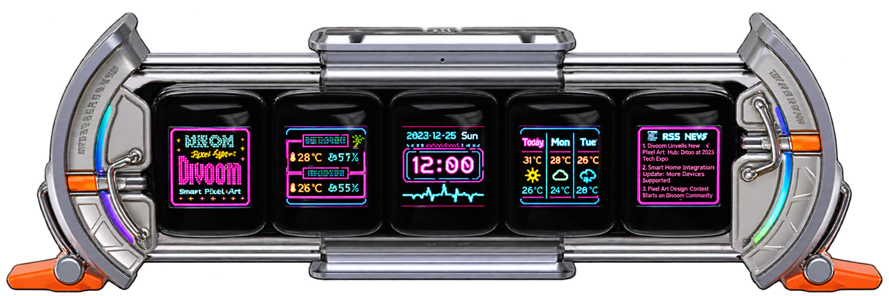
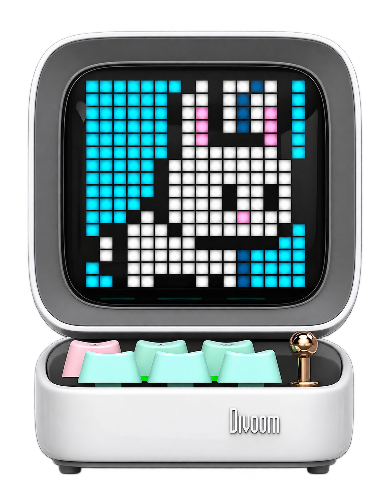

<div align="center">
  
  <h1>Divoom Hub</h1>
  <p><strong>Ваша музыка — на экранах Divoom.</strong></p>
  <p>Обложки, циферблаты и подсветка для Times Gate и Ditoo Pro.<br>Одно приложение на Windows, несколько устройств, ваши настройки.</p>

  <p>
    
    
    
    
  </p>

  <p>
    <a href="#версии-и-скачивание"><strong>Скачать</strong></a> ·
    <a href="#подключение">Подключение</a> ·
    <a href="#сборка-из-исходников">Сборка</a> ·
    <a href="docs/architecture.md">Как это работает</a> ·
    <a href="https://github.com/iriskaaf/divoom-hub/issues">Сообщить об ошибке</a>
  </p>
</div>

---

## Два устройства. Разные возможности.

<table>
  <tr>
    <td align="center" width="50%">
      <br>
      <strong>Times Gate</strong><br>
      <sub>Wi-Fi · пять экранов 128 × 128</sub>
    </td>
    <td align="center" width="50%">
      <br>
      <strong>Ditoo Pro</strong><br>
      <sub>Bluetooth · пиксельный экран 16 × 16</sub>
    </td>
  </tr>
  <tr>
    <td>Циферблаты, обложка на среднем экране, собственные изображения и подсветка под музыку.</td>
    <td>Пиксельные обложки треков, настройка обработки изображения, яркости и режима ожидания.</td>
  </tr>
</table>

## Возможности

- **Музыка из Windows.** Трек и обложка из медиасессии — без входа в аккаунт. Можно ограничить источник Spotify или использовать другие плееры.
- **Spotify Web API.** Получение текущего трека, когда музыка играет на другом устройстве.
- **Свои циферблаты.** Встроенные стили, настройка цветов, изменение порядка и импорт/экспорт паков.
- **Цвета обложки.** Циферблат и подсветка Times Gate могут подстраиваться под музыку; на паузе возвращаются ручные настройки.
- **Несколько устройств.** Добавление, переименование и отдельные настройки для нескольких Times Gate и Ditoo Pro в WinUI-версии.
- **Работа из трея.** Быстрые действия с музыкой и циферблатами, светлая и тёмная темы интерфейса.

## Версии и скачивание

| Версия | Для чего | Где взять |
| :--- | :--- | :--- |
| **WinUI 3** | Актуальная разработка: C#-интерфейс и Python-бэкенд | [Исходники](winui/) · [Инструкция сборки](#сборка-из-исходников) |
| **Python Legacy · 1.8.1** | Прежнее самостоятельное приложение на PySide6 | [Скачать ZIP для Windows](https://github.com/iriskaaf/divoom-hub/releases/download/legacy-v1.8.1/DivoomHub-1.8.1-legacy-windows.zip) · [Релиз](https://github.com/iriskaaf/divoom-hub/releases/tag/legacy-v1.8.1) |
| **WinUI Archive · 18.11.2026** | Сохранившаяся промежуточная сборка | [Архивный релиз](https://github.com/iriskaaf/divoom-hub/releases/tag/archive-winui-2026-11-18) |

> [!NOTE]
> Legacy ZIP содержит готовое приложение: распакуйте **всю папку** и запустите `DivoomHub.exe`. Архивная WinUI-сборка требует отдельного Python-окружения и не заменяет актуальную версию из `main`.

## Подключение

### Times Gate

1. Подключите часы к Wi-Fi через мобильное приложение Divoom.
2. Подключите компьютер к той же локальной сети.
3. Добавьте Times Gate в Divoom Hub и укажите IP-адрес и LocalToken из настроек устройства в приложении Divoom.

### Ditoo Pro

1. Откройте **Параметры Windows → Bluetooth и устройства**.
2. Выполните сопряжение с **DitooPro-Audio**.
3. Добавьте Ditoo Pro в Divoom Hub. Если соединение занято приложением Divoom на телефоне, отключите его Bluetooth-соединение с устройством.

### Источник музыки

| Источник | Когда выбирать | Настройка |
| :--- | :--- | :--- |
| **Медиасессия Windows** | Музыка играет на этом компьютере | Без авторизации; плеер должен передавать данные в Windows SMTC |
| **Spotify Web API** | Музыка играет на другом устройстве | Client ID своего приложения Spotify и вход в аккаунт |

Для Spotify Web API добавьте в настройках приложения Spotify redirect URI:

```text
http://127.0.0.1:8888/callback
```

Закрытие окна сворачивает Divoom Hub в трей. Чтобы завершить программу, выберите **«Выход»** в меню трея. Times Gate возвращается к встроенному циферблату, если эта настройка включена.

## Сборка из исходников

Нужны **Windows x64**, **.NET 8 SDK**, **Python 3.13**, **PowerShell 7** и инструменты разработки **WinUI/XAML**. Используется Windows App SDK 2.6.5.

```powershell
git clone https://github.com/iriskaaf/divoom-hub.git
cd divoom-hub

py -3.13 -m venv legacy/.venv
legacy/.venv/Scripts/python -m pip install -r legacy/requirements.txt pyinstaller
pwsh -File winui/Build.ps1
```

| Сборка | Исполняемый файл |
| :--- | :--- |
| Основная | `winui/artifacts/DivoomHub.WinUI/divoom-hub-winui3.exe` |
| TEST | `winui/artifacts/test/divoom-hub-winui3_TEST.exe` |

Скрипт упаковывает Python, .NET и Windows App SDK. Для переноса готового приложения копируйте всю папку сборки.

<details>
<summary><strong>Разработка в Visual Studio</strong></summary>

Откройте `winui/divoom-hub-winui3.slnx`, выберите **x64 → Unpackaged** и запустите проект. Python-код и окружение берутся из соседней папки `legacy`.

Если Python-проект находится отдельно, задайте переменную `DIVOOM_HUB_PYTHON_ROOT` или передайте путь через `Build.ps1 -PythonRoot`.

</details>

<details>
<summary><strong>Профили и тестовая версия</strong></summary>

| Версия | Папка данных |
| :--- | :--- |
| WinUI | `%LOCALAPPDATA%/DivoomHub.WinUI` |
| WinUI TEST | `%LOCALAPPDATA%/DivoomHub.WinUI_TEST` |
| Python Legacy | `%LOCALAPPDATA%/DivoomHub` |

WinUI хранит LocalToken и авторизацию Spotify в Windows Credential Manager.

TEST при каждом запуске показывает приветствие и читает настройки Python-версии, если они есть. Исходный Python-профиль не перезаписывается. Перед подключением реальных устройств из TEST завершите другую версию через трей.

</details>

## Под капотом

```text
divoom-hub/
├── winui/                    C# / WinUI 3
│   ├── Pages/                Главная, устройства, настройки и мастер
│   ├── Controls/             Общие элементы интерфейса и трей
│   ├── Models/               Профили, устройства и паки циферблатов
│   ├── Services/             IPC, учётные данные и автозапуск
│   └── Backend/              Python-процесс и проверки обмена данными
├── legacy/                   Самостоятельная Python-версия
│   ├── core/                 Музыка, обложки и настройки
│   ├── bluetooth/            Подключение и протокол Ditoo
│   ├── timesgate/            HTTP, циферблаты и подсветка Times Gate
│   ├── gui/                  Прежний интерфейс PySide6
│   └── tests/                Проверки Python
└── docs/                     Описание архитектуры
```

WinUI общается с Python через строки JSON в стандартных потоках дочернего процесса. Один музыкальный движок обслуживает несколько независимых обработчиков устройств. Модули `core`, `bluetooth` и `timesgate` используются обеими версиями; PySide6 в WinUI-бэкенд не загружается.

**[Разбор архитектуры и пути «медиасессия → обложка → средний экран» →](docs/architecture.md)**

## Проверки

```powershell
Push-Location legacy
.venv/Scripts/python -m pytest -q
Pop-Location

legacy/.venv/Scripts/python winui/Backend/smoke_test.py winui/artifacts/DivoomHub.WinUI/Backend/DivoomHub.Backend.exe
legacy/.venv/Scripts/python winui/Backend/smoke_cover_flow.py (Resolve-Path legacy)
```

WinUI также поддерживает `--ui-smoke-test <абсолютный-путь-к-отчёту>`: проверяются страницы в двух темах, мастер, выбор цвета, меню, паки циферблатов и IPC с Python. Сетевые проверки используют локальный имитатор Times Gate.

Цветопередача реальных светодиодов и одновременные Bluetooth-соединения проверяются отдельно на устройствах.

## Обратная связь

Нашли ошибку? [Создайте issue](https://github.com/iriskaaf/divoom-hub/issues) и укажите версию приложения, модель устройства, версию Windows и шаги воспроизведения. Для проблем интерфейса приложите скриншот. LocalToken и данные авторизации публиковать не нужно.

---

<div align="center">
  <sub>Независимый проект. Не является официальным приложением Divoom или Spotify.</sub><br>
  <sub><a href="THIRD_PARTY_NOTICES.md">Сторонние компоненты, шрифты и лицензии</a></sub>
</div>
